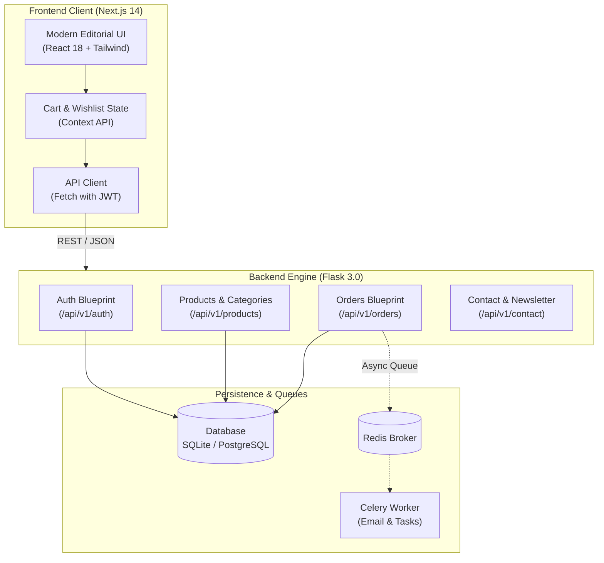

<div align="center">

```
██╗   ██╗ ██████╗ ██╗██████╗ 
██║   ██║██╔═══██╗██║██╔══██╗
██║   ██║██║   ██║██║██║  ██║
╚██╗ ██╔╝██║   ██║██║██║  ██║
 ╚████╔╝ ╚██████╔╝██║██████╔╝
  ╚═══╝   ╚═════╝ ╚═╝╚═════╝ 
  E  S  S  E  N  T  I  A  L  S
```

# ✦ VOID ESSENTIALS ✦
### *Architectural Minimalist E-Commerce Platform*

[](https://nextjs.org/)
[](https://react.dev/)
[](https://tailwindcss.com/)
[](https://flask.palletsprojects.com/)
[](https://python.org/)
[](https://www.postgresql.org/)
[](https://redis.io/)
[](LICENSE)

<br/>

> *"Essentials, without excess."*  
> An editorial full-stack clothing e-commerce web platform inspired by luxury atelier lookbooks, minimalist typography, and high-performance decoupled web engineering.

<p align="center">
  <a href="#-key-features">Features</a> •
  <a href="#-architecture">Architecture</a> •
  <a href="#-quick-start">Quick Start</a> •
  <a href="#-api-reference">API Docs</a> •
  <a href="#-environment-variables">Config</a> •
  <a href="RUN.md">Run Guide (RUN.md)</a>
</p>

</div>

---

## 📖 Table of Contents

- [✦ Brand Philosophy & Visual Identity](#-brand-philosophy--visual-identity)
- [✨ Key Features](#-key-features)
- [🏗️ System Architecture](#️-system-architecture)
- [💻 Tech Stack](#-tech-stack)
- [📁 Project Structure](#-project-structure)
- [⚡ Quick Start & Setup](#-quick-start--setup)
- [🔑 Default Admin Credentials](#-default-admin-credentials)
- [📡 API Reference](#-api-reference)
- [⚙️ Environment Variables](#️-environment-variables)
- [📜 License](#-license)

---

## ✦ Brand Philosophy & Visual Identity

**VOID ESSENTIALS** balances haute-couture editorial aesthetics with brutalist, minimalist digital architecture:

* **Monochrome Palette**: High-contrast jet black (`#0A0A0A`), crisp stark whites, and subdued slate tones.
* **Editorial Hero Canvas**: Monolithic watermark brand lettering layered behind cutout fashion figures, asymmetrical typography (*"FASHION THAT MOVES WITH YOU"*), and seasonal badge accents.
* **Curated Capsule Portals**: Dedicated visual gateways for **MEN**, **WOMEN**, **ACCESSORIES**, and **ARCHIVE**.
* **Heavyweight Textiles**: Product design modeling archival restock cycles, 320–500 GSM organic cotton textiles, and private fitting services.
* **Micro-Interactions**: Cinematic hover reveals, dynamic slide-in cart drawers, and smooth GSAP/Anime.js page transitions.

---

## ✨ Key Features

| Domain | Capabilities |
| :--- | :--- |
| **🛍️ Modern Storefront** | Next.js 14 App Router, dynamic server/client components, responsive drawer cart, instant search & wishlist. |
| **🎨 Editorial Lookbook** | Asymmetrical layouts, high-res lookbook photography, fabric GSM detail tabs, and interactive size/color matrix. |
| **🔒 Secure Authentication** | Flask-JWT-Extended tokens, bcrypt password hashing, token refreshes, and protected user profiles. |
| **📦 Order Management** | Automated checkout calculation, order reference generation (`VOID-XXXXXXXX`), and order tracking endpoints. |
| **⚡ Graceful Celery Fallback** | Background asynchronous processing for transactional emails & exports with zero-config in-process fallback when Redis is absent. |
| **🌱 Auto-Seeded Database** | SQLite or PostgreSQL auto-initialized on first run with complete product categories and rich mock catalog. |

---

## 🏗️ System Architecture



---

## 💻 Tech Stack

### Frontend
- **Framework**: [Next.js 14](https://nextjs.org/) (App Router)
- **Library**: [React 18](https://react.dev/)
- **Styling**: [Tailwind CSS 3.4](https://tailwindcss.com/)
- **Animation**: [GSAP 3.12](https://greensock.com/gsap/) & [Anime.js](https://animejs.com/)
- **Icons**: [Lucide React](https://lucide.dev/)

### Backend
- **Framework**: [Flask 3.0](https://flask.palletsprojects.com/)
- **ORM**: [Flask-SQLAlchemy 3.1](https://flask-sqlalchemy.palletsprojects.com/)
- **Security**: [Flask-JWT-Extended](https://flask-jwt-extended.readthedocs.io/), Werkzeug Security
- **Cross-Origin**: [Flask-CORS](https://flask-cors.readthedocs.io/)
- **Task Queue**: [Celery 5.3](https://docs.celeryq.dev/) + [Redis 5.0](https://redis.io/) (with graceful sync fallback)

---

## 📁 Project Structure

```
Void/
├── backend/                        # Flask REST API Engine
│   ├── app/
│   │   ├── models/                 # User, Product, Category, Order models
│   │   ├── routes/                 # Blueprints (auth, products, orders, contact)
│   │   ├── services/               # Database seeder & catalog filler
│   │   └── tasks/                  # Celery background workers
│   ├── instance/                   # SQLite database instance
│   ├── config.py                   # App configuration & environment loader
│   ├── requirements.txt            # Python dependencies
│   └── run.py                      # Backend entry point (Port 5001)
├── frontend/                       # Next.js 14 Storefront
│   ├── app/                        # App Router (pages: home, catalog, product, checkout)
│   ├── components/                 # UI components (Header, Hero, CartDrawer, Footer)
│   ├── lib/                        # API client, cart context, utilities
│   ├── styles/                     # Tailwind globals & typography
│   ├── package.json                # Node dependencies & scripts
│   └── tailwind.config.js          # Brand theme configuration
├── docs/                           # Architectural specs & design guides
├── run-dev.bat                     # Windows 1-click launcher batch script
├── run-dev.ps1                     # Windows 1-click launcher PowerShell script
├── RUN.md                          # Dedicated run and operational manual
├── .env.example                    # Environment variable template
└── README.md                       # Project documentation
```

---

## ⚡ Quick Start & Setup

> [!TIP]
> For step-by-step instructions and single-command startup, refer to **[`RUN.md`](RUN.md)**.

### 1. One-Click Launch (Windows)
Double-click **`run-dev.bat`** or run in PowerShell:
```powershell
.\run-dev.ps1
```

---

### 2. Manual Startup (Two Terminals)

#### 🐍 Terminal 1: Backend (Flask)
```bash
# Navigate to project root
cd Void

# Install Python requirements
python -m pip install -r backend/requirements.txt

# Start Flask API server (Port 5001)
python backend/run.py
```

#### 🌐 Terminal 2: Frontend (Next.js)
```bash
# Navigate to frontend folder
cd Void/frontend

# Install dependencies
npm install

# Start development server (Port 3000)
npm run dev
```

Visit **[http://localhost:3000](http://localhost:3000)** in your browser.

---

## 🔑 Default Admin Credentials

When the backend boots for the first time, it automatically creates the database schema and populates it with categories, catalog items, and a default superuser:

```yaml
Email: admin@voidessentials.store
Password: VoidSecure2026!
Role: Admin
```

---

## 📡 API Reference

Base URL: `http://localhost:5001/api/v1`

| Method | Endpoint | Description | Auth Required |
| :--- | :--- | :--- | :---: |
| `GET` | `/health` | Service health & database connectivity probe | No |
| `POST` | `/auth/register` | Register a new customer account | No |
| `POST` | `/auth/login` | Authenticate and obtain JWT access & refresh tokens | No |
| `POST` | `/auth/refresh` | Refresh an expired access token | Refresh Token |
| `GET` | `/auth/profile` | Retrieve the authenticated user's profile | JWT Bearer |
| `GET` | `/categories` | List all available clothing categories | No |
| `GET` | `/products` | List all products (supports `?category=`, `?sort=`, `?search=`) | No |
| `GET` | `/products/<id>` | Retrieve full details for a single product | No |
| `POST` | `/orders` | Create an order with cart items and shipping details | JWT Optional |
| `GET` | `/orders` | List order history for the logged-in customer | JWT Bearer |
| `POST` | `/contact` | Submit inquiry form or newsletter subscription | No |

---

## ⚙️ Environment Variables

Copy `.env.example` to `.env` to customize settings:

```ini
# Flask Backend
FLASK_ENV=development
PORT=5001
SECRET_KEY=void-secret-key-production-32-chars
DATABASE_URL=sqlite:///void_store.db

# JWT Security
JWT_SECRET_KEY=void-jwt-secret-token-key
JWT_ACCESS_TOKEN_EXPIRES=3600

# Redis & Celery (Optional)
REDIS_URL=redis://localhost:6379/0

# Next.js Frontend
NEXT_PUBLIC_API_URL=http://localhost:5001/api/v1
NEXT_PUBLIC_STORE_NAME="VOID ESSENTIALS"
NEXT_PUBLIC_SUPPORT_EMAIL="support@voidessentials.store"
```

---

## 📜 License

Distributed under the **MIT License**. See `LICENSE` for details.

<div align="center">
  <sub>VOID ESSENTIALS Atelier • New York & Worldwide • Handcrafted with architectural precision.</sub>
</div>
