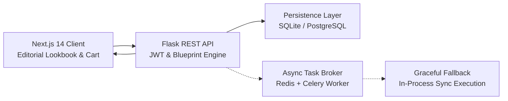
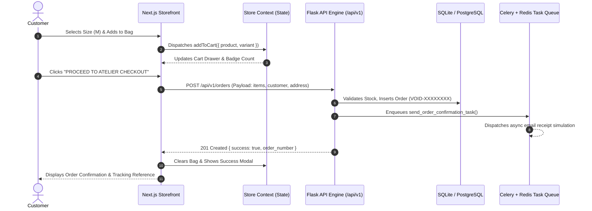

<div align="center">

# ✦ VOID ESSENTIALS
### Architectural Minimalist E-Commerce Platform & Haute-Couture Digital Atelier

[](https://nextjs.org/)
[](https://react.dev/)
[](https://tailwindcss.com/)
[](https://python.org/)
[](https://flask.palletsprojects.com/)
[](https://www.sqlalchemy.org/)
[](https://www.postgresql.org/)
[](https://redis.io/)
[](https://jwt.io/)
[](LICENSE)

<p align="center">
  <b>VOID ESSENTIALS consolidates editorial lookbook aesthetics and decoupled, high-performance web engineering into a luxury e-commerce experience.</b><br/>
  It unifies pure Supima cotton apparel curation, real-time catalog filtering, dynamic cart drawers, instant checkout generation, zero-config Celery fallback queues, and an auto-seeded REST API engine.
</p>

<p align="center">
  <a href="#-the-problem--the-void-vision"><b>The Vision</b></a> •
  <a href="#-key-features"><b>Key Features</b></a> •
  <a href="#-system-architecture"><b>Architecture</b></a> •
  <a href="#-feature-comparison"><b>Comparison</b></a> •
  <a href="#-quick-start"><b>Quick Start</b></a> •
  <a href="#-keyboard--operational-shortcuts"><b>Shortcuts</b></a> •
  <a href="#-api-reference"><b>API Docs</b></a> •
  <a href="#-deep-dive-technical-documentation"><b>Docs</b></a>
</p>

---


</div>

---

## 💡 The Problem & The Void Vision

Traditional fashion e-commerce platforms suffer from bloated templates, fragile monolithic backends, and noisy visual clutter:
- 🔁 **Monolithic Bloat & Slow Page Loads:** Heavy storefront platforms (Shopify themes, Magento) force dozens of unoptimized tracking scripts, third-party plugin CSS waterfalls, and layout shifts that ruin the luxury shopping feel.
- 📉 **Generic Templates & Cookie-Cutter Design:** Most fashion sites lack editorial character, relying on generic product grids with zero narrative pacing, low-contrast typography, and absent material disclosures.
- ⚠️ **Fragile Background Pipelines:** Standard setups break when external message queues (Redis / RabbitMQ) disconnect, leading to dropped checkout confirmations, unhandled 500 errors, and broken email dispatches.

### The Void Essentials Solution:
> **VOID ESSENTIALS fuses haute-couture editorial lookbook pacing, brutalist architectural restraint, and decoupled full-stack engineering into a radical, permanent web atelier.**



---

## ✨ Key Features

### 🛍️ 1. Editorial Hero Canvas & Haute-Couture Pacing
- **Monolithic Brand Lettering:** Oversized watermark typography (`VOID`) layered behind an authentic atelier fashion cutout with interactive mouse depth parallax.
- **Cinematic Micro-Interactions:** Smooth GSAP timeline entrance animations, hover image zoom transitions, and non-intrusive seasonal badge announcements.
- **Strict Aesthetic Discipline:** Jet-black (`#0A0A0A`), stark white, and natural bone monochrome palette inspired directly by luxury fashion ateliers.

### 🧵 2. Authentic Textile Architecture & Pure Supima
- **Heavyweight Form (320–500 GSM):** Detailed textile disclosures featuring pure long-staple combed Supima cotton knit, dense French Terry fleece, and heavyweight cotton twill.
- **Zero-Branding Philosophy:** Garments engineered with blind-stitched hems, structured dropped shoulders, and zero external logos.
- **Full Atelier Provenance:** Verified manufacturing origin disclosures (Surat, Gujarat, India) with interactive care instruction tabs.

### 🗂️ 3. Dynamic Category Portals & Instant Filter Tabs
- **Curated Capsule Portals:** Dedicated high-contrast visual gateways for **MEN**, **WOMEN**, **ACCESSORIES**, and **ARCHIVE**.
- **Interactive Silhouettes Filter:** Zero-reload tab filtering across Jackets & Coats, Topwear & Hoodies, and Pants & Denim.
- **Full Catalog Search & Sort:** Price ascending/descending, newest arrivals, archival vault exclusivity, and instant multi-token search modal.

### 🛒 4. Reactive Slide-In Cart & Simulated Checkout
- **Side Drawer Bag:** Slide-in cart drawer displaying live item count, size/color variant chips, item quantity selectors, and free shipping progress bars.
- **Instant Order Number Generation:** Generates authentic sequential atelier order codes (`VOID-XXXXXXXX`) upon checkout confirmation.
- **Persistent Local State:** Synchronizes bag items and customer wishlists across sessions with real-time badge counters.

### 🔒 5. Dual-Tier JWT Authentication & User Profiles
- **Stateless Tokens:** Access tokens (1-hour expiration) and Refresh tokens (30-day longevity) managed via Flask-JWT-Extended.
- **Password Hashing:** Industry-standard bcrypt password hashing with Werkzeug security.
- **Customer Account Drawer:** One-click sign in/register modal, customer order history lookup, and role-based admin permission gates.

### ⚡ 6. Graceful Background Worker Fallback
- **Asynchronous Pipelines:** Celery worker integration for simulated transactional order emails, dispatch alerts, and CSV catalog exports.
- **Zero-Config In-Process Fallback:** If Redis or Celery is absent during local development, tasks gracefully execute in-process synchronously without throwing HTTP 500 errors.

### 📱 7. Responsive Mobile-First Architecture
- **Symmetric Nav Alignment:** Mobile hamburger navigation drawer, centered brand mark, and touch-friendly utility targets.
- **Pillarbox-Free Fitting:** Dynamically locked aspect ratios ensuring full-body lookbook imagery displays without awkward cropping on mobile screens.
- **Offline / Local Network Proxy:** Next.js automatic API rewrite rules routing `/api/v1` traffic seamlessly to Flask on desktop and mobile Wi-Fi alike.

### 🌱 8. Fully Idempotent Auto-Seeded Database
- **Zero-Configuration Start:** Automatically creates schemas and populates all 20 curated products, variants, images, and categories on boot.
- **Conflict-Free Seeding:** Unique slug checks and transaction rollbacks prevent database locks and integrity errors on repeated server reloads.

---

## 🏗️ System Architecture

VOID ESSENTIALS decouples the high-performance Next.js 14 client from the Flask REST API engine, ensuring lightning-fast static delivery and secure transactional persistence.

```
+-----------------------------------------------------------------------------------------------+
|                                    VOID ESSENTIALS PLATFORM                                   |
|                                                                                               |
|  +-------------------------------------------------------------+  +------------------------+  |
|  |                 TOP ANNOUNCEMENT BAR (Shipping & Status)    |  |    CART SLIDE DRAWER   |  |
|  | [• COMPLIMENTARY DISPATCH ON ORDERS OVER RS. 2,500]         |  |                        |  |
|  +-------------------------------------------------------------+  | - Selected Silhouettes |  |
|  |                     NAVBAR (Sticky Header)                  |  | - Size & Color Chips   |  |
|  | [HOME] [SHOP ∨] [ABOUT] [CONTACT]   [ VOID ]   [🔍] [👤] [🛍️]|  | - Quantity Incrementer |  |
|  +-------------------------------------------------------------+  | - Subtotal & Taxes     |  |
|  |                     HERO LOOKBOOK CANVAS                    |  | - 1-Click Checkout     |  |
|  |  +----------------------------+  +-----------------------+  |  +------------------------+  |
|  |  |   EDITORIAL TYPOGRAPHY     |  |   HIGH-FASHION MODEL  |  |  |    SEARCH & AUTH       |  |
|  |  |                            |  |   ASPECT-LOCKED CARD  |  |  |                        |  |
|  |  |  - "FASHION THAT MOVES"    |  |                       |  |  |  - Full Catalog Search |  |
|  |  |  - New Collection 25/26    |  |  - Pure Supima Fit    |  |  |  - JWT Login / Register|  |
|  |  |  - Dual Action CTAs        |  |  - Ambient Parallax   |  |  |  - Wishlist Vault      |  |
|  |  +----------------------------+  +-----------------------+  |  +------------------------+  |
|  +-------------------------------------------------------------+  |   REST API ENGINE      |  |
|  |             CURATED CATALOG & VISION EDITORIALS             |  |                        |  |
|  |  [All Pieces] [Jackets] [Topwear] [Pants & Denim Archive]  |  |  - Flask Blueprints    |  |
|  +-------------------------------------------------------------+  |  - SQLite / PostgreSQL |  |
|  |             ATELIER FOOTER (Disclosures & Concierge)        |  |  - Redis & Celery Queue|  |
|  +-------------------------------------------------------------+  +------------------------+  |
+-----------------------------------------------------------------------------------------------+
```

### End-to-End Checkout & Order Flow:


---

## 📊 Feature Comparison

| Capability | VOID ESSENTIALS | Standard Shopify Theme | WooCommerce | Generic Next.js Template |
| :--- | :---: | :---: | :---: | :---: |
| **Editorial Lookbook Pacing** | ✅ High-Fashion Atelier | ❌ Cookie-Cutter Grid | ❌ Generic Blog Layout | ⚠️ Basic Tailwind Grid |
| **Decoupled Architecture** | ✅ Next.js 14 + Flask 3 | ❌ Liquid Monolith | ❌ PHP Monolith | ⚠️ Frontend Only (Mocked) |
| **Pure Supima Textiles Focus**| ✅ GSM & Fabric Specs | ❌ Generic Descriptions| ❌ None | ❌ Dummy Lorem Ipsum |
| **Dynamic Aspect-Ratio Cards**| ✅ Zero-Crop Guaranteed| ❌ Inconsistent Crops | ❌ Distorted Cards | ⚠️ Fixed Height Zoom |
| **Zero-Config Async Queue** | ✅ Graceful Celery Fallback| ❌ Expensive Apps | ⚠️ Complex Cron Setup | ❌ No Queue |
| **Idempotent DB Seeding** | ✅ Automatic on Boot | ❌ Manual CSV Import | ❌ Manual Setup | ⚠️ Static JSON file |
| **Local Network Mobile Proxy**| ✅ Built-in Next.js Rewrite| ❌ None | ❌ None | ❌ Broken Localhost calls |
| **Default Admin Credentials** | ✅ Instant Ready | ❌ Cloud Setup Required | ❌ Manual Wizard | ❌ None |
| **Open-Source & Self-Hosted** | ✅ 100% Free (MIT) | ❌ \$39+/month + Fees | ⚠️ Hosting Maintenance | ✅ Varies |

---

## 🚀 Quick Start

### Prerequisites
- **Node.js:** v18.x or v20.x
- **Python:** 3.10+ (Python 3.11 recommended)
- **Git**

### Installation

```bash
# 1. Clone the repository
git clone https://github.com/Zyreexx/Void_Essential.git
cd Void_Essential

# 2. Install Backend Python requirements
python -m pip install -r backend/requirements.txt

# 3. Install Frontend Node dependencies
cd frontend
npm install
cd ..
```

---

### Running the Project

#### Option A: One-Click Launchers (Windows)
- **Double-click** `run-dev.bat` in the root folder.
- Or run in PowerShell:
  ```powershell
  .\run-dev.ps1
  ```
*This automatically spins up both the Flask REST API (port 5001) and Next.js Storefront (port 3000) in separate terminals.*

---

#### Option B: Two-Terminal Manual Start

```bash
# Terminal 1: Backend Flask API Engine
python backend/run.py
```
> API runs at: **http://localhost:5001** (auto-seeds database on first boot)

```bash
# Terminal 2: Frontend Next.js Storefront
cd frontend
npm run dev
```
> Storefront runs at: **http://localhost:3000**

---

## 🔑 Default Admin Credentials

When the backend boots for the first time, it automatically creates the database schema and seeds the default superuser:

| Attribute | Specification |
| :--- | :--- |
| **Email** | `admin@voidessentials.store` |
| **Password** | `VoidSecure2026!` |
| **Role** | Super Administrator |
| **Atelier Channel** | `support@voidessentials.store` |

---

## ⌨️ Keyboard & Operational Shortcuts

| Action | Command / Shortcut | Scope |
| :--- | :--- | :--- |
| **Launch Full Dev Environment** | `.\run-dev.ps1` or double-click `run-dev.bat` | Terminal / Explorer |
| **Reset / Re-seed Database** | `Remove-Item backend/instance/void_store.db -Force` | PowerShell Root |
| **Clear Next.js Cache** | `Remove-Item -Recurse -Force frontend/.next` | PowerShell Root |
| **Run Standalone Seeder** | `python backend/app/services/seeder.py` | Python Root |
| **Kill Port 5001 (Backend)** | `Stop-Process -Id (Get-NetTCPConnection -LocalPort 5001).OwningProcess -Force` | Windows PowerShell |
| **Kill Port 3000 (Frontend)** | `Stop-Process -Id (Get-NetTCPConnection -LocalPort 3000).OwningProcess -Force` | Windows PowerShell |

---

## 📡 API Reference

Base URL: `http://localhost:5001/api/v1`

| Method | Endpoint | Description | Auth Required |
| :--- | :--- | :--- | :---: |
| `GET` | `/health` | Service health & database connectivity probe | No |
| `POST` | `/auth/register` | Register customer account with email & password | No |
| `POST` | `/auth/login` | Authenticate customer and obtain JWT access tokens | No |
| `POST` | `/auth/refresh` | Refresh an expired access token | Refresh Token |
| `GET` | `/auth/profile` | Retrieve customer profile and order history | Bearer Token |
| `GET` | `/categories` | List all curated atelier clothing categories | No |
| `GET` | `/products` | List catalog items with filters (`category`, `sort`, `search`) | No |
| `GET` | `/products/featured`| Retrieve top curated featured atelier garments | No |
| `GET` | `/products/<slug>` | Retrieve single garment specifications and variants | No |
| `POST` | `/orders` | Submit customer order and receive order reference | Optional |
| `GET` | `/orders/<order_no>`| Check order status, shipment tracking, and items | Optional |
| `POST` | `/contact` | Submit concierge support request or newsletter signup | No |

---

## 🎯 5-Minute Live Demo Script

Follow this path to evaluate VOID ESSENTIALS:

1. **Launch Workspace:** Launch via `.\run-dev.ps1` or `run-dev.bat`. Open `http://localhost:3000`.
2. **Hero Lookbook Experience:** Observe the oversized `VOID` lettering awakening, followed by the full-body model card floating smoothly with ambient depth parallax.
3. **Explore Silhouettes:** Scroll to **Curated Silhouettes** and toggle between `All Pieces`, `Jackets & Coats`, `Topwear & Hoodies`, and `Pants & Denim`.
4. **Inspect Atelier Specs:** Click any product (e.g. *Shirt Jacket* or *Oversized Hoodie*). Notice the GSM fabric disclosures, size toggles, and color chips.
5. **Slide-in Bag & Wishlist:** Click the heart icon to save to wishlist. Add items to bag to trigger the slide-in cart drawer. Notice the live subtotal calculations.
6. **Checkout Simulation:** Click *Proceed to Checkout*, enter simulated details, and submit to generate your unique `VOID-XXXXXXXX` order code.
7. **Mobile Responsiveness:** Open Chrome DevTools (<kbd>F12</kbd>), toggle device emulation (<kbd>Ctrl</kbd>+<kbd>Shift</kbd>+<kbd>M</kbd>), and test the mobile hamburger menu and touch-friendly card grid.

---

## 📚 Deep-Dive Technical Documentation

Comprehensive architectural specifications and planning documents are available in the [`docs/`](docs/) directory:

- 📐 [**DESIGN.md**](docs/design.md) — Visual reference mapping, typography, color palettes, and editorial layout rules.
- 🏛️ [**ARCHITECTURE.md**](docs/architecture.md) — Detailed decoupling rules, database schemas, and background worker fallback.
- 📋 [**PRD.md**](docs/prd.md) — Product requirements, user personas, functional specifications, and KPI goals.
- 🔄 [**PHASES.md**](docs/phases.md) — Project milestones, implementation roadmap, and version delivery logs.
- 🧠 [**MEMORY.md**](docs/memory.md) — Persistent project context, atelier constraints, and design decisions.
- ⚖️ [**RULES.md**](docs/rules.md) — Code quality standards, styling guidelines, and engineering axioms.
- 🚀 [**RUN.md**](RUN.md) — Standalone operational guide with zero-friction copy-paste commands.

---

## 🛡️ Security & Privacy

- **Stateless JWT Security:** User sessions are verified via signed JSON Web Tokens with strict expiration windows.
- **SQL Injection Prevention:** All database operations utilize SQLAlchemy ORM parameterized queries.
- **CORS Protection:** Cross-Origin Resource Sharing is configured to prevent unauthorized domain access.
- **Local Fallback Protection:** Zero external cloud dependencies required for local testing or production self-hosting.

---

## 📄 License

This project is licensed under the **MIT License** — see the [LICENSE](LICENSE) file for details.

<div align="center">
  <sub>VOID ESSENTIALS Atelier • New York & Worldwide • Handcrafted with architectural precision.</sub>
</div>
